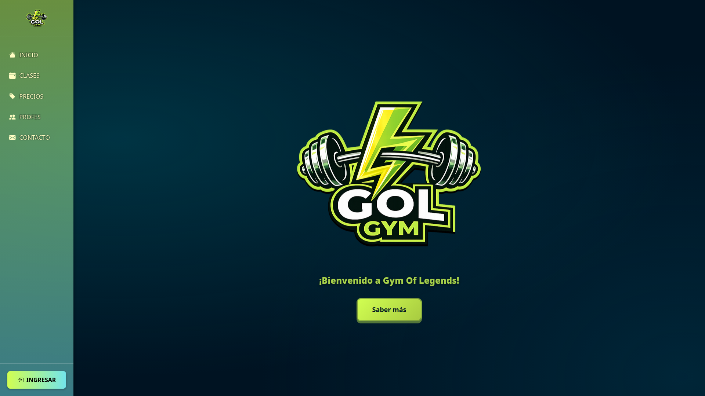

<h1 align="center">
🏋️‍♂️ GOL GYM — Proyecto Programación 1
</h1>

<p align="center">
  Sistema de gestión integral para un gimnasio. Administración de usuarios, rutinas, clases, cuotas y membresías.
</p>



## Figma
[👉 Acceder al diseño en Figma](https://www.figma.com/file/eMVja4xZXQaOs7R6Dxjofd/Grupo_B?type=design&node-id=0%3A1&mode=design&t=wmPhyalveFt5GsZg-1)

---

## Características

### Gestión de Usuarios y Roles
- **Administrador**: Control total sobre usuarios, clases, cuotas y permisos del sistema.
- **Profesor**: Gestión de alumnos asignados y creación de rutinas personalizadas.
- **Alumno**: Acceso a perfil personal, rutinas y estado de membresía.

### Planificación de Entrenamientos
- Planes semanales detallados (Lunes a Sábado) por alumno y profesor.
- Notificaciones automáticas por email al crear o actualizar una rutina.

### Suscripción y Cuotas 🎮
- Sistema de membresías con 5 planes temáticos (saga Street Fighter).
- Estados automáticos: Pendiente → Por vencer → Rechazado → Vencida.
- Recargo automático del 10% por mora.
- 3 días de gracia antes de suspensión automática de cuenta.
- Emails transaccionales: INSERT COIN, PLAYER 1 READY, GAME OVER, PLAYER BLOCKED.

### Gestión de Clases
- Cronograma de clases grupales con horarios y profesores asignados.
- Relación muchos a muchos entre clases y profesores.

### Formulario de Contacto
- Formulario público en la página principal que envía consultas al email del gym.

---

## Stack tecnológico

### Backend
- **Lenguaje:** Python 3.x
- **Framework:** Flask + Flask-RESTful
- **Base de Datos:** SQLite + SQLAlchemy ORM + Flask-Migrate
- **Autenticación:** JWT (Flask-JWT-Extended)
- **Email:** Flask-Mail (SMTP Gmail)
- **Seguridad:** Hash de contraseñas con Werkzeug

### Frontend
- **Framework:** Angular 16
- **Lenguaje:** TypeScript
- **Estilos:** CSS3
- **HTTP:** RxJS + HttpClient

---

## Instalación y ejecución

### Backend
```bash
cd backend
bash install.sh          # Crea virtualenv e instala dependencias
cp .env-example .env     # Configurar variables de entorno
bash boot.sh             # Inicia el servidor en http://localhost:5000
```

### Cargar los planes de membresía (primera vez)
```bash
cd backend
python3 seed_planes.py
```

### Frontend
```bash
cd frontend/gol_gym
npm install
ng serve -o              # Inicia en http://localhost:4200
```

---

## Modelo de datos

```
Usuario (dni PK)
  ├─── 1:1 → Alumno  (edad, peso, altura, sexo, estado_membresia, plan)
  │            ├─── 1:N → Planificacion
  │            └─── 1:N → Cuota  ← nuevo
  └─── 1:1 → Profesor (especialidad, foto, descripcion)
               ├─── 1:N → Planificacion
               └─── M:N → Clase (via procla)

Permiso  (rol, recurso, metodo)
Precio   (nombre, precio, descripcion)   ← planes Street Fighter
```

### Entidades principales
| Entidad | Descripción |
|---------|-------------|
| `Usuario` | Datos base y credenciales. Roles: admin, profesor, user |
| `Alumno` | Métricas físicas, plan y estado de membresía |
| `Profesor` | Especialidad, foto y bio |
| `Planificacion` | Rutina semanal (Lunes–Sábado) por alumno/profesor |
| `Clase` | Actividades grupales con horario y día |
| `Cuota` | Registro mensual de cobro con estado calculado |
| `Precio` | Planes de membresía (5 planes Street Fighter) |
| `Permiso` | Control de acceso dinámico por rol/recurso/método |

---

## Documentación técnica

Documentación detallada disponible en [`docs/`](./docs/README.md):

- [Arquitectura general](docs/arquitectura.md)
- [Modelos de datos](docs/backend/modelos.md)
- [Endpoints REST](docs/backend/endpoints.md)
- [Autenticación y permisos](docs/backend/auth.md)
- [Módulo de Cuotas](docs/backend/cuotas.md)
- [Componentes Angular](docs/frontend/componentes.md)
- [Servicios Angular](docs/frontend/servicios.md)
- [Routing y guards](docs/frontend/routing.md)
- [Flujos de usuario](docs/flujos.md)
- [Posibles mejoras](docs/mejoras.md)

---

<table align="center">
  <tr>
    <td>
      <p align="center">
        <samp>
          <b>
            <br>
            
          </b>
          <br>
          
        </samp>
      </p>
    </td>
    <td>
      <p align="center">
        <samp>
          <b>
            <br>
            
          </b>
          <br>
          
        </samp>
      </p>
    </td>
  </tr>
  <tr>
    <td>
      <p align="center">
        <samp>
          <b>
            <br>
            
          </b>
          <br>
          
        </samp>
      </p>
    </td>
    <td>
      <p align="center">
        <samp>
          <b>
            <br>
            
          </b>
          <br>
          
        </samp>
      </p>
    </td>
  </tr>
</table>

---
<p align="center">Proyecto Final — Cátedra de Programación 1 — Universidad de Mendoza</p>
